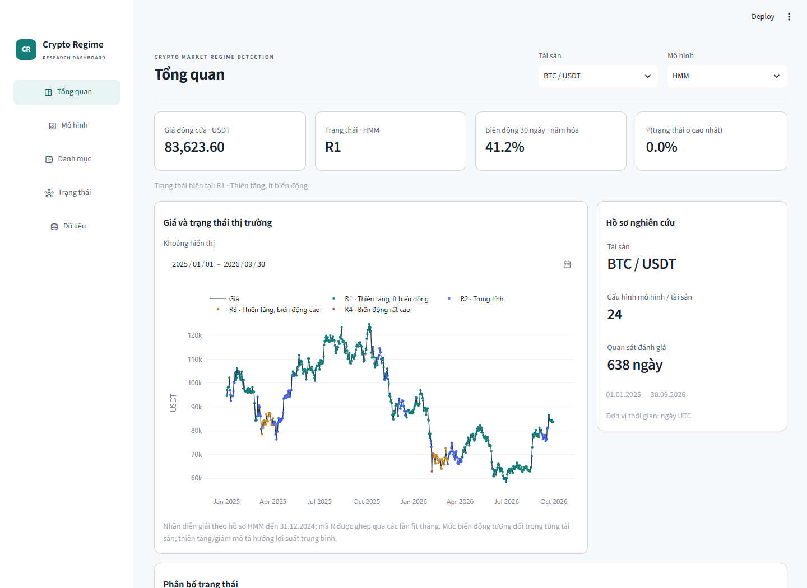

# AI Crypto Regime Detection

**Cập nhật 19/10/2026:** bổ sung FRED (VIX, Treasury, S&P500), ICE DXY qua Yahoo, Coin Metrics (vốn hóa), DefiLlama (stablecoin/TVL); giữ OHLCV/funding/OI Binance đã có. Thêm TVTP macro/crypto/liquidity/supply, HDBSCAN (cả chọn theo density), BOCPD và independent MS-GARCH. Chia mẫu và ngưỡng RMSE của bản gốc **chưa thay đổi** theo yêu cầu người dùng. Các mở rộng là phân tích hồi cứu, không có holdout mới untouched.

## Bản tổng hợp nghiên cứu

Mở [tom_tat_ket_qua.html](results/tom_tat_ket_qua.html): một file offline gồm bảng, 5 hình SVG, dữ liệu/biến/tham số, phương pháp và kết luận của toàn nghiên cứu. Có thể tải tại trang Dữ liệu. Tạo lại không cần raw hoặc fit mô hình: `python -m regime.cli report`. Nhãn R trên HMM chính BTC/ETH là mô tả theo hồ sơ đến 31.12.2024; [cơ sở chia mẫu và nhãn](docs/METHODOLOGY.md).

## Clone và mở kết quả

Cần Python 3.12. Sau khi clone, chạy tại thư mục repo:

```powershell
py -3.12 -m venv .venv
.\.venv\Scripts\python.exe -m pip install -r requirements.lock
.\.venv\Scripts\python.exe -m streamlit run dashboard.py
```

Linux/macOS: `python3.12 -m venv .venv`, `.venv/bin/python -m pip install -r requirements.lock`, `.venv/bin/python -m streamlit run dashboard.py`.

Dashboard trình bày toàn nghiên cứu qua 5 trang: Tổng quan, Mô hình, Danh mục, Trạng thái, Dữ liệu. Đọc kết quả ngay từ Git, không cần raw/cache trên máy tác giả. Trang Mô hình chọn mật độ return, mật độ đa biến hoặc phân cụm; biểu đồ mặc định có mọi mô hình đã tính return log score. Muốn xem chuỗi ngoại sinh, bấm **Tải chuỗi dữ liệu** trong trang Dữ liệu hoặc chạy:

```powershell
.\.venv\Scripts\python.exe -m regime.cli external-data
.\.venv\Scripts\python.exe -m regime.cli extend
```

Lệnh thứ nhất tải bổ sung miễn phí, không cần API key, chuẩn hóa UTC/đơn vị và đối chiếu hash dữ liệu đã chốt. Lệnh thứ hai xác minh và tái sử dụng kết quả công bố nếu có; `extend --recompute` dựng lại dữ liệu/bảng với cache mô hình hợp lệ. Khi chưa có kết quả mới, `extend` thực hiện fit toàn bộ. Không tạo PDF hoặc gọi publish/adequacy. Chạy `python -m regime.cli verify-extensions` để kiểm tra độc lập. File core `config.json`, `regime/adequacy.py` và các bảng kết quả gốc được kiểm tra giữ nguyên.

Dữ liệu ngoại sinh gốc và panel đầy đủ **không đưa vào Git** vì SP500 có hạn chế phân phối lại; script tải và manifest/hash vẫn có trong repo. Tái lập phụ thuộc nguồn tiếp tục cung cấp cùng lịch sử: nếu nguồn sửa quá khứ hoặc hết cửa sổ lịch sử (FRED SP500 chỉ giữ 10 năm), pipeline dừng rõ ràng thay vì âm thầm nhận dữ liệu khác. Đây không phải cam kết archive tồn tại vĩnh viễn.

Kết quả: **7 bảng CSV chung trong `results/tables/`**; dự báo, hệ số, chẩn đoán và đường danh mục trong **`results/research.zip`**. Giữ nguyên 316 artifact logic, chỉ lưu 224 nội dung khác nhau (loại 92 bản sao giống từng byte). Dashboard đọc trực tiếp; CLI tự giải gói/đóng lại khi tính toán. Xem [cấu trúc và cách đọc](results/README.md). Chia mẫu, RMSE và nhãn R giữ nguyên; không ước lượng lại ở lần tổ chức kết quả/giao diện này. Cơ sở và giả định: [EXTERNAL_METHODS](docs/EXTERNAL_METHODS.md). Spec: [CAPABILITY_MAP](CAPABILITY_MAP.md); plan: [tasks/plan.md](tasks/plan.md), trạng thái: [tasks/todo.md](tasks/todo.md).

Không sinh bài/PDF mới trong lượt này. Bài và PDF bên dưới là **bản gốc Binance-only ngày 16/10**, chưa bao gồm thí nghiệm mở rộng.

---


Nghiên cứu BTC/USDT và ETH/USDT từ Binance, kèm dashboard tiếng Việt. Dữ liệu spot raw từ **17/08/2017**, snapshot đến **30/09/2026 UTC**. Nguồn miễn phí, không cần API key.

**Kết quả chính:** quy tắc validation + recovery chọn BTC 4 trạng thái, ETH 5 trạng thái trong lưới 2–5. HMM có joint density tốt hơn GMM, nhưng chiến lược regime-aware của HMM chính không cải thiện volatility targeting trong test sau chi phí. Không coi việc phân tách regime là bằng chứng tạo alpha.

## Xem sản phẩm ngay trên máy hiện tại

Chạy `run_dashboard.cmd`, hoặc tại thư mục repository:

```powershell
.\.venv\Scripts\python.exe -m streamlit run dashboard.py
```

Mở địa chỉ được hiển thị sau khi chạy (mặc định **http://127.0.0.1:8501**). Dashboard đọc kết quả đã tính, không tải mạng hoặc huấn luyện lại khi đổi bộ lọc.

- [Bài nghiên cứu PDF](paper/bao_cao_nghien_cuu.pdf)
- [Bản Markdown để sửa](paper/bao_cao_nghien_cuu.md)
- [Bảng hiệu quả danh mục](results/tables/portfolio_performance.csv)
- [Hình PNG/PDF](paper/figures/)
- [Tiến trình và giới hạn bàn giao](docs/progress.md)



## Cài trên máy mới

Cần Python 3.12 và Git. Toàn bộ đường dẫn bên dưới chạy tại thư mục repository.

```powershell
py -3.12 -m venv .venv
.\.venv\Scripts\python.exe -m pip install -r requirements.lock
.\.venv\Scripts\python.exe -m streamlit run dashboard.py
```

Quy trình nghiên cứu được kiểm chứng trên Windows. Để xem snapshot dashboard trên Linux/macOS, dùng `python3.12` và `.venv/bin/python`. Kết quả gọn trong `results/` đã được đưa vào Git nên có thể xem dashboard ngay; không cần tải lại raw.

## Tái tạo nghiên cứu

```powershell
$env:OPENBLAS_NUM_THREADS = "1"
$env:OMP_NUM_THREADS = "1"
$env:PYTHONUTF8 = "1"
.\.venv\Scripts\python.exe -m regime.cli all
```

Lệnh này tải/kiểm tra raw, tạo feature, chọn mô hình trên validation, kiểm chứng cỡ mẫu, khóa protocol, đánh giá holdout, bootstrap tham số và xuất bài/bảng/hình. Việc tính mô hình có thể mất nhiều phút; không có cam kết thời gian cố định.

Có thể chạy từng bước:

| Lệnh sau `python -m regime.cli` | Chức năng |
|---|---|
| `data` | Spot + funding + OI, checksum, audit |
| `select` | HMM/GMM/Markov Switching và cohort B/C bằng validation |
| `adequacy` | Recovery, heavy-tail, learning curve, nested origins |
| `evaluate` | Khóa lựa chọn và đánh giá cuối theo tháng |
| `intervals` | Bootstrap tham số chỉ dùng lịch sử trước test |
| `publish` | Bảng, hình PNG/PDF và bản thảo Markdown |
| `verify` | Hash artifact và code khoa học đã khóa |
| `reproduce` | Refit 18 mô hình trong thư mục sạch, đối chiếu bảng và dự báo |

`reproduce` dùng raw cache và môi trường đã khóa, không phải lần cài lạnh thứ hai. Thư mục kết quả tạm được tự dọn. Dung sai đối chiếu giữ ở rtol=1e-8, atol=1e-10.

Nếu nguồn sửa archive hoặc bạn đổi config, hash có thể khác. Hãy dùng checkout/thư mục nghiên cứu riêng cho snapshot mới; giữ bản công bố để đối chiếu. Không dùng lại cache validation của một cấu hình khác.

## Xuất lại PDF bài nghiên cứu

PDF đã có sẵn. Nếu muốn sửa bản thảo và xuất lại:

```powershell
.\.venv\Scripts\python.exe -m pip install "reportlab==4.4.9"
.\.venv\Scripts\python.exe tools/render_paper.py
.\.venv\Scripts\python.exe -c "from regime.publish import update_hashes; update_hashes()"
```

Renderer dùng Arial trên Windows và DejaVu Sans từ Matplotlib trên hệ khác. Khác font hoặc metadata có thể khiến PDF không trùng byte; kiểm chứng mô hình so số liệu, không coi PDF phải giống byte trên mọi hệ điều hành.

## Cấu trúc gọn

```text
regime/          dữ liệu, feature, mô hình, đánh giá, xuất kết quả
dashboard.py     giao diện bảy tab
config.json      nguồn, calendar, split, seed, chi phí
results/         snapshot gọn dùng chung cho bài và dashboard
paper/           bản thảo, PDF, BibTeX, hình
docs/            dictionary, phương pháp, quyết định, QA và tiến trình
tests/           một tệp kiểm thử lõi, không có bộ scaffold dư
tools/           renderer PDF tùy chọn
```

Raw, môi trường Python và cache thử nghiệm được giữ cục bộ, bỏ khỏi Git. Inventory URL/checksum ở `data/manifest_archives.csv`; audit ở `outputs/data_audit/`.

## Thiết kế và giới hạn cần đọc

- Mẫu A: 1.902 ngày train, 731 ngày validation, 638 ngày test. Đọc [cơ sở thiết kế](docs/decisions/001-research-design.md) và [lý do đổi biến khối lượng](docs/decisions/002-relative-volume.md).
- Funding/OI có ngày bắt đầu riêng; không lấp lùi về 2017. Các cohort mở rộng mang tính khám phá.
- Tín hiệu close t khớp open t+2, thanh lý tại open cuối test; 10 bps chính, 5/25 bps độ nhạy; long/cash, target volatility 40%/năm.
- Chỉ so joint score khi cùng bộ biến. Xác suất sigma cao nhất là proxy rủi ro, không phải nhãn khủng hoảng đã xác thực.
- Archive được tải hồi cứu; không có đầy đủ historical vintages để bảo đảm point-in-time tuyệt đối.
- Recovery 100 lần có sai số Monte Carlo đáng kể; không chứng minh một cỡ mẫu tối thiểu phổ quát hoặc số regime thật.
- **Lịch sử sửa lỗi RNG:** audit tái lập v1 phát hiện statsmodels 0.15 cần truyền `rng` trực tiếp. Bản v2 dùng `rng=11`, giữ v1 và công khai thay đổi. Holdout đã được xem ở v1; v2 là tái tính sửa lỗi, không phải holdout mới chưa từng được xem. Xem [revision trong gói kết quả](results/README.md) và [lịch sử](docs/history/).
- Literature matrix ghi rõ phần chỉ đọc abstract/preview; không nhận là tổng quan hệ thống toàn văn.

## Kiểm tra code

```powershell
.\.venv\Scripts\python.exe -m pytest -q
.\.venv\Scripts\ruff.exe check --config pyproject.toml regime tests tools dashboard.py
```

Kiểm thử tập trung vào timestamp ms/us, ngày thiếu, causal feature/filter, funding/OI, mật độ return trước quan sát, execution delay/phí và seed của Markov Switching. Kiểm tra trình duyệt được thực hiện riêng, không để lại script thử dùng một lần.

Remote GitHub đã cấu hình; chưa push. Các commit cục bộ giữ lịch sử triển khai và sửa lỗi.
