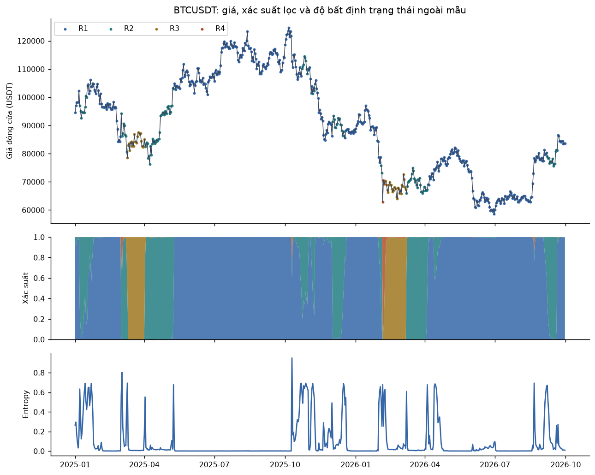
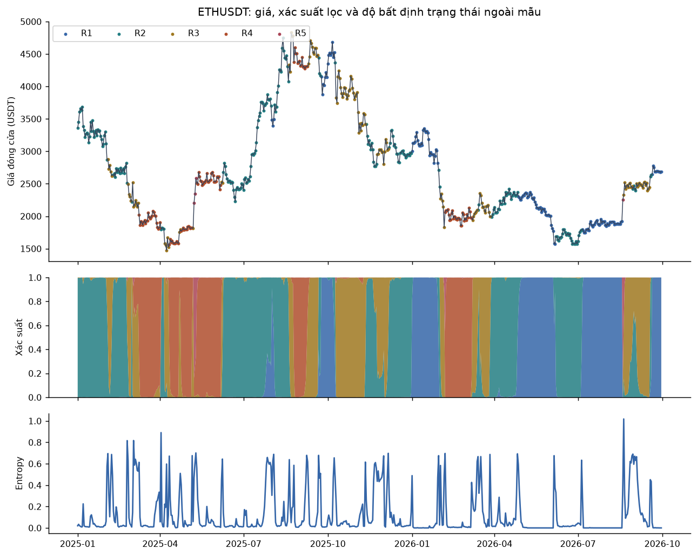
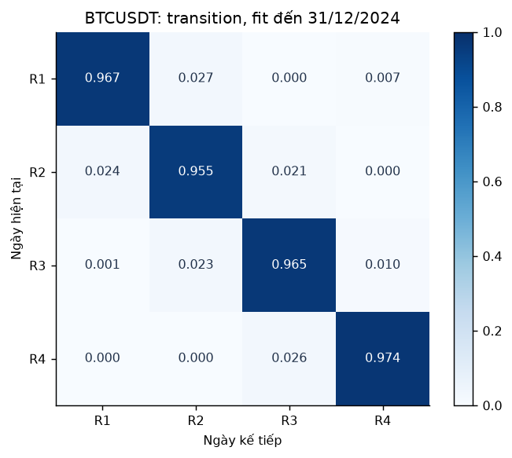
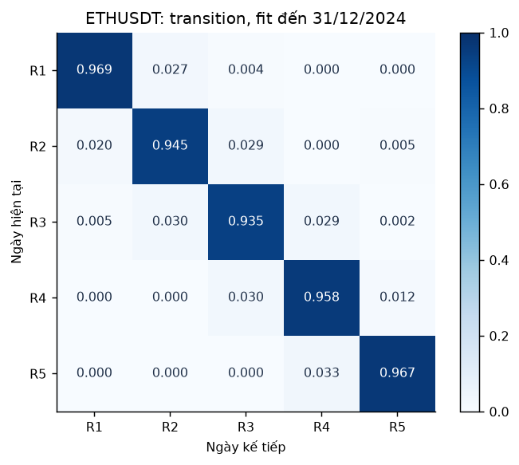
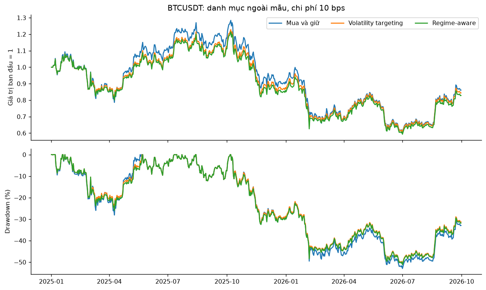
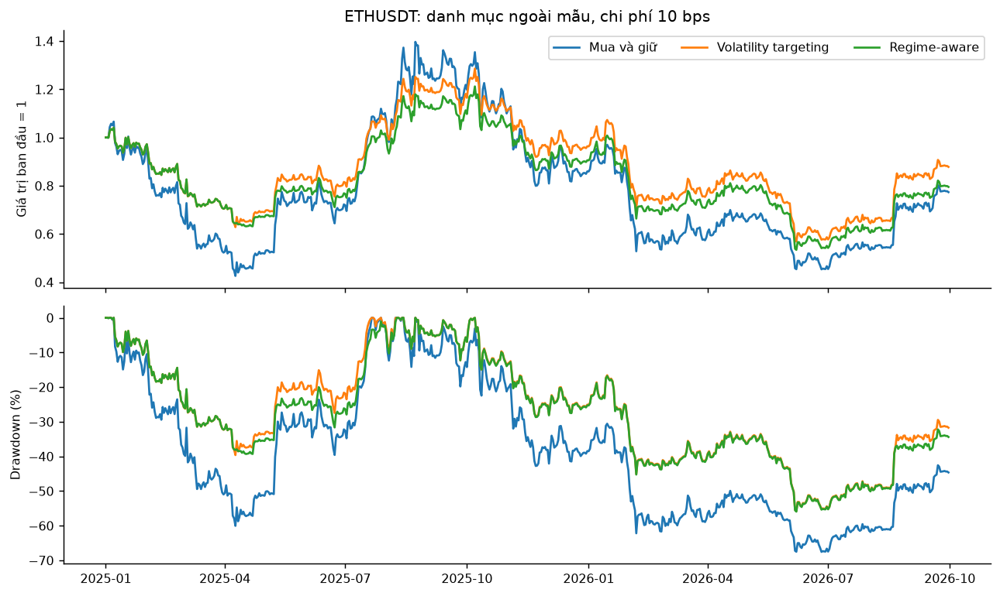

# Phát hiện trạng thái rủi ro của Bitcoin và Ethereum trên Binance
## Hidden Markov Models, Markov Switching và giá trị của tín hiệu trong quản trị danh mục

Bản thảo nghiên cứu tính từ dữ liệu thực. Ngày lập: 16/10/2026. Snapshot chốt: 30/09/2026 UTC.
Phiên bản protocol: 458be57e3dae78c2b299fa898d93e914b6e26ec66db2fe43ca74564cddf65a48.

**Lịch sử phiên bản:** thiết kế ban đầu khóa trước lượt đánh giá đầu, hash 716cb4d3e006e66e263e6a51c638d974a9afe6f425238a9acc569a43bfad06d1. Bản hiện tại sửa seed của Generator trong statsmodels sau khi kiểm tra tái lập phát hiện sai khác. Holdout đã được xem ở v1; đây là tái tính có công khai sửa lỗi, không phải một holdout mới chưa từng được xem. Không thay đặc tả, ngưỡng hoặc quy tắc theo điểm test.

## Tóm tắt

Nghiên cứu xây dựng mô hình trạng thái ẩn cho BTCUSDT và ETHUSDT từ lịch sử Binance bắt đầu tháng 8/2017. Bộ biến chính gồm log return, volatility thực hiện 30 ngày và khối lượng tương đối, với chuẩn hóa chỉ dùng quá khứ. Dữ liệu được kiểm tra checksum, lịch UTC, đơn vị timestamp, ngày thiếu và điều kiện quan sát đầy đủ. Thiết kế phân tách train đến 2022, validation 2023–2024 và đánh giá cuối 638 ngày từ 2025 đến 30/09/2026; đồng thời kiểm tra nhiều origin trước test. Trong lưới 2–5 trạng thái, quy tắc kết hợp điểm validation và recovery simulation chọn BTC 4 trạng thái, ETH 5 trạng thái. BTC 5 trạng thái bị loại dù có điểm validation cao hơn vì không đạt ngưỡng sai số transition. HMM được so sánh với GMM, K-means và Markov Switching AR; funding/OI được xem xét trên các cohort riêng. Hiệu quả kinh tế được đo bằng danh mục long/cash với thực thi trễ hai ngày và ba kịch bản chi phí. Kết quả tại chi phí 10 bps: BTCUSDT: CAGR regime-aware -10.25%, volatility targeting -9.27%; ETHUSDT: CAGR regime-aware -12.31%, volatility targeting -7.18%. Kết quả phải được đọc cùng khoảng tin cậy, độ nhạy theo seed và giới hạn của mô hình Gaussian; phân tách trạng thái không tự chứng minh khả năng tạo lợi nhuận vượt trội.

**Từ khóa:** cryptocurrency; Hidden Markov Model; Markov Switching; time-series validation; quản trị rủi ro.

## 1. Đặt vấn đề và câu hỏi nghiên cứu

Biến động, hoạt động giao dịch và điều kiện phái sinh của crypto thay đổi theo thời gian. Một bộ phân loại cứng dựa trên mức giảm giá đơn lẻ không biểu diễn được bất định của trạng thái. HMM cho phép mô hình hóa phân phối quan sát phụ thuộc trạng thái ẩn và độ bền của từng trạng thái.

Nghiên cứu hỏi: (RQ1) số trạng thái nào trong lưới đặt trước vừa phù hợp ngoài mẫu vừa có khả năng khôi phục tham số; (RQ2) các trạng thái khác nhau về return và volatility ra sao; (RQ3) funding và volume trễ có liên quan đến transition hay bổ sung thông tin dự báo; (RQ4) HMM có biểu hiện khác GMM/K-means và Markov Switching không; (RQ5) giảm exposure theo xác suất trạng thái sigma cao nhất có cải thiện volatility targeting sau chi phí hay không.

Phạm vi là hai cặp spot trên một sàn và các biến perpetual Binance liên quan. Nghiên cứu không dùng VIX/DXY hoặc suy rộng tự động sang toàn thị trường. Các nhãn R1…RK là nhãn mô hình, không phải nhãn bull/bear/stress có ground truth.

## 2. Cơ sở phương pháp

Giudici và Abu Hashish (2020) nghiên cứu trạng thái ẩn của giá Bitcoin bằng HMM. Figà-Talamanca, Focardi và Patacca (2021) xem xét trạng thái riêng và chung của nhiều cryptocurrency; kết quả trong mẫu của họ không tạo ra một K cố định cho mọi thị trường. Koki, Leonardos và Piliouras (2022) so sánh các HMM Bayesian và NHHMM có predictors. Các nghiên cứu này tạo nền tảng cho câu hỏi về regime và dự báo, nhưng nghiên cứu hiện tại không nhận là tái tạo nguyên vẹn thiết kế hoặc kết quả của họ.

Pakštaitė et al. (2025) nghiên cứu HMM và các biến macro/Bitcoin; Shakourloo và Azimli (2026) xét MS-GARCH và Hidden Markov Copula. Hai hướng này giúp định vị phạm vi nhưng không được triển khai đầy đủ ở đây vì giới hạn Binance-only và mục tiêu codebase gọn. Đóng góp của dự án là quy trình audit dữ liệu, kiểm chứng khả năng ước lượng và so sánh ngoài mẫu minh bạch trên snapshot mới, không phải đề xuất một bộ ước lượng HMM mới. Literature matrix ghi rõ phần tài liệu chỉ được đọc abstract/preview, không trình bày đây là tổng quan hệ thống toàn văn.

Hamilton (1989) cung cấp nền tảng Markov Switching cho chuỗi thời gian có phân phối thay đổi theo trạng thái. Trong HMM, likelihood tốt và số trạng thái có ý nghĩa kinh tế là hai vấn đề khác nhau. Pohle et al. (2017) chỉ ra khó khăn khi chọn K chỉ bằng tiêu chí thông tin trong mô hình có sai đặc tả. Vì vậy nghiên cứu sử dụng cả validation, diagnostics và mô phỏng recovery.

Đánh giá giữ thứ tự thời gian và nhiều origin giúp quan sát sự phụ thuộc kết quả vào giai đoạn. Cerqueira, Torgo và Mozetič (2020) nghiên cứu các phương pháp ước lượng hiệu năng dự báo chuỗi thời gian. Thiết kế mô phỏng ở đây trình bày rõ mục tiêu, DGP, phương pháp và chỉ tiêu theo tinh thần hướng dẫn Morris, White và Crowther (2019). Những tài liệu này hỗ trợ cách làm; chúng không chứng minh sẵn rằng các mốc cuối 2022/2024 hoặc 1.902 ngày là tối ưu.

## 3. Dữ liệu, phạm vi mẫu và tiền xử lý

### 3.1. Nguồn và ngày bắt đầu

Spot lấy từ Binance public archive theo tháng và xác minh SHA-256. Archive 1 phút ngày đầu của cả hai cặp bắt đầu 17/08/2017 lúc 04:00 UTC, chỉ có 1.200 phút. Vì vậy raw giữ ngày 17/08 nhưng feature bắt đầu từ ngày đầy đủ 18/08. Sau 60 log return, ngày analysis đầu tiên là 17/10/2017. Cutoff 30/09/2026 là tháng hoàn chỉnh trước ngày thiết kế, phục vụ tái lập snapshot; không phải điểm gãy kinh tế.

Mỗi tài sản có 3.332 ngày spot raw, không thiếu ngày trong phạm vi. Timestamp spot chuyển từ milliseconds sang microseconds từ đầu 2025 theo tài liệu Binance và được chuẩn hóa trước khi ghép. Funding giữ từng settlement thực có, sau đó cộng theo ngày UTC. OI dùng snapshot dương cuối ngày trong 15 phút trước nửa đêm; ngày không đạt giữ thiếu. Có 1.763/1.765 ngày OI cuối ngày hợp lệ cho mỗi tài sản; các snapshot lỗi được đếm riêng và raw không sửa.

| asset | dataset | first_date | last_date | expected_days | valid_days | coverage | invalid_snapshots | missing_days |
| --- | --- | --- | --- | --- | --- | --- | --- | --- |
| BTCUSDT | spot | 2017-08-17 | 2026-09-30 | 3332 | 3332 | 1.0000 | 0 | 0 |
| ETHUSDT | spot | 2017-08-17 | 2026-09-30 | 3332 | 3332 | 1.0000 | 0 | 0 |
| BTCUSDT | funding | 2019-09-10 | 2026-09-30 | 2578 | 2578 | 1.0000 | 0 | 0 |
| ETHUSDT | funding | 2019-11-27 | 2026-09-30 | 2500 | 2500 | 1.0000 | 0 | 0 |
| BTCUSDT | oi | 2021-12-01 | 2026-09-30 | 1765 | 1763 | 0.9989 | 475 | 2 |
| ETHUSDT | oi | 2021-12-01 | 2026-09-30 | 1765 | 1763 | 0.9989 | 218 | 2 |

### 3.2. Chia mẫu có điều kiện và các cohort

Mẫu A có 1.902 ngày train, 731 ngày validation và 638 ngày test. Ranh giới lịch được khai báo trước và được đối chiếu bằng recovery, learning curve và nested temporal origins 2020–2024. Không chọn một origin vì nó cho kết quả đẹp nhất.

Mẫu B chỉ bắt đầu 28/11/2019, sau ngày funding ETH đầu tiên chưa đầy đủ. Mẫu C dùng log-change OI từ 02/12/2021; train đến 2023, validation 2024. Số ngày hợp lệ khác lịch vì không lấp OI thiếu. Các mở rộng là thăm dò; chưa được chứng nhận recovery như A. Khi đánh giá đóng góp OI/funding, mật độ return được so trên cùng các ngày của holdout, không so trực tiếp joint density khác chiều.

| asset | cohort | split | calendar_days | complete_feature_days | excluded_days |
| --- | --- | --- | --- | --- | --- |
| BTCUSDT | A | train | 1902 | 1902 | 0 |
| BTCUSDT | A | validation | 731 | 731 | 0 |
| BTCUSDT | A | test | 638 | 638 | 0 |
| BTCUSDT | B | train | 1130 | 1130 | 0 |
| BTCUSDT | B | validation | 731 | 731 | 0 |
| BTCUSDT | B | test | 638 | 638 | 0 |
| BTCUSDT | C | train | 760 | 758 | 2 |
| BTCUSDT | C | validation | 366 | 364 | 2 |
| BTCUSDT | C | test | 638 | 638 | 0 |
| ETHUSDT | A | train | 1902 | 1902 | 0 |
| ETHUSDT | A | validation | 731 | 731 | 0 |
| ETHUSDT | A | test | 638 | 638 | 0 |
| ETHUSDT | B | train | 1130 | 1130 | 0 |
| ETHUSDT | B | validation | 731 | 731 | 0 |
| ETHUSDT | B | test | 638 | 638 | 0 |
| ETHUSDT | C | train | 760 | 758 | 2 |
| ETHUSDT | C | validation | 366 | 364 | 2 |
| ETHUSDT | C | test | 638 | 638 | 0 |

### 3.3. Biến và xử lý nhân quả

Return là ln(C_t/C_t−1). Volatility năm hóa bằng SD rolling return × sqrt(365), ddof=1. Volume tương đối là z-score log(1+quote volume) hôm nay so với 30 ngày trước; scaler mô hình chỉ fit lịch sử train. Không forward-fill giá/OI hoặc coi thiếu là 0; không nối return bắc qua ngày thiếu. Funding và OI được giữ riêng với spot vì khác thị trường.

Pilot khối lượng tuyệt đối tạo trạng thái gần hấp thụ, phản ánh tăng trưởng quy mô sàn nhiều hơn điều kiện tương đối. Thay đổi sang volume_z được quyết định bằng train trước test và lưu trong ADR-002. Kết quả pilot thất bại được giữ, không trình bày như đặc tả chính thành công.

Thống kê mô tả theo split:

| asset | split | n | mean_log_return | annual_volatility | skewness | excess_kurtosis |
| --- | --- | --- | --- | --- | --- | --- |
| BTCUSDT | train | 1902 | 0.0006 | 0.7830 | -1.0487 | 14.1870 |
| BTCUSDT | validation | 731 | 0.0024 | 0.4831 | 0.4594 | 2.3573 |
| BTCUSDT | test | 638 | -0.0002 | 0.4357 | -0.1315 | 5.0458 |
| ETHUSDT | train | 1902 | 0.0007 | 1.0020 | -1.0089 | 10.9589 |
| ETHUSDT | validation | 731 | 0.0014 | 0.5600 | 0.4576 | 3.5839 |
| ETHUSDT | test | 638 | -0.0003 | 0.6942 | 0.2118 | 4.1361 |

## 4. Mô hình, lựa chọn và thiết kế đánh giá

### 4.1. HMM và nhận diện trạng thái

Cho S_t thuộc {1,…,K}, P(S_t=j|S_t−1=i)=p_ij. Với vector Y_t gồm ba biến chính, giả định Y_t|S_t=k có phân phối Gaussian với mean riêng và covariance diagonal. Số tham số tự do là (K−1)+K(K−1)+2Kd; d=3 cho 15/26/39/54 tham số khi K=2/3/4/5.

Ước lượng EM dùng 20 khởi tạo đầu kỳ; chọn nghiệm hội tụ có likelihood train cao nhất. Mỗi đầu tháng refit expanding với ba khởi tạo cố định, chỉ dùng các ngày trước tháng đó. Chuỗi bị gián đoạn được phân đoạn, không nén thời gian. Nhãn đầu kỳ xếp theo sigma return; nhãn giữa các refit ghép theo profile bằng thuật toán Hungarian.

Tín hiệu dùng xác suất lọc P(S_t|Y_1:t), không dùng smoothing toàn mẫu. Xác suất ngày kế tiếp tính từ filtered probability nhân ma trận transition của mô hình đã fit. Mật độ return dự báo được tính từ prior trước quan sát ngày t. Mật độ joint có điều chỉnh Jacobian scaler.

### 4.2. Cơ sở về độ đủ mẫu

Ngưỡng dự án khai báo: trung bình RMSE toàn ma trận transition ≤0,05; RMSE tương đối sigma return ≤20%; tỷ lệ hội tụ ≥90%. Đây là lựa chọn độ chính xác, không phải chuẩn học thuật cố định. Mỗi ứng viên có 100 mẫu Gaussian DGP từ train, fit lại bằng cùng bộ ước lượng 20 khởi tạo. Sai số Monte Carlo của các trung bình được công bố.

| asset | k | heavy_tail | repetitions | transition_rmse | transition_rmse_mcse | volatility_relative_rmse | passes_project_precision_targets |
| --- | --- | --- | --- | --- | --- | --- | --- |
| BTCUSDT | 5 | False | 100 | 0.0755 | 0.0119 | 0.1054 | False |
| BTCUSDT | 4 | False | 100 | 0.0415 | 0.0102 | 0.0613 | True |
| BTCUSDT | 4 | True | 50 | 0.0187 | 0.0053 | 0.0663 | — |
| ETHUSDT | 5 | False | 100 | 0.0362 | 0.0085 | 0.0622 | True |
| ETHUSDT | 5 | True | 50 | 0.0459 | 0.0106 | 0.1687 | — |

BTC K=5 không qua ngưỡng; BTC K=4 và ETH K=5 qua. ETH chạm biên trên lưới nên không được gọi là số trạng thái thật tối ưu. Heavy-tail t5 là kiểm tra sai đặc tả riêng. Parametric bootstrap cho persistence, duration, mean và sigma được báo trong parameter_intervals.csv, chỉ dùng dữ liệu trước 2025; khoảng này có tính điều kiện theo Gaussian DGP và chỉ 100 lần lặp nên lượng hóa đuôi còn thô.

Learning curve 730/1.095/1.460/1.902 ngày và các seed cho thấy nhãn không hoàn toàn ổn định. K của outer folds cũng thay đổi theo lịch sử. Sai số Monte Carlo của RMSE transition BTC K=4 khoảng 0,0102, còn ETH K=5 khoảng 0,0085; quyết định đạt dựa trên ước lượng điểm gần ngưỡng cần được xem thận trọng, chưa phải chứng minh cỡ mẫu tối thiểu. Vì vậy việc qua recovery không đồng nghĩa mọi nghiệm hoặc mọi giai đoạn đều ổn định; không có kết luận rằng đúng ngày cuối 2022 là ranh giới duy nhất phù hợp.

### 4.3. Đối chứng và mở rộng

GMM diagonal chọn K bằng validation, K-means dùng cùng K với HMM chính. HMM return-only và Markov Switching AR(1) chọn K=2 hoặc 3 bằng validation. K-means chỉ có nhãn và ứng dụng danh mục, không có predictive density.

NHHMM mở rộng dùng Gaussian Markov Switching hai trạng thái, transition logit theo funding và volume_z trễ hai ngày. Mô hình MS0 transition cố định dùng đúng cùng cohort và ngày để đối chứng. Hai covariate chuẩn hóa bằng train. OI bổ sung dưới dạng emission trong HMM C; không tuyên bố đã ước lượng OI-TVTP khi dữ liệu bị thiếu.

### 4.4. Danh mục và suy luận

Volatility targeting dùng w=min(1,0,4/rv30); regime-aware nhân thêm (1−P_high_vol). Long/cash, không leverage/short, cash return 0. Tín hiệu close t giao dịch tại open t+2. Hai ngày đầu giữ cash, cuối kỳ thanh lý tại open 30/09/2026; không dùng giá tương lai. Hạch toán cập nhật giá trị tài sản trước tái cân bằng và tính phí trên notional giao dịch thật, gồm vào/ra.

Chi phí giả định 5/10/25 bps mỗi chiều; 10 bps là kết quả chính. Đây là kịch bản tổng chi phí giản lược, không phải báo giá phí Binance hoặc mô hình market impact. CAGR dùng số khoảng ngày; Sharpe dùng return tài khoản thực, năm hóa 365.

Chênh lệch mật độ và Sharpe dùng paired circular block bootstrap 1.000 lần, block chính 30 ngày; Sharpe kiểm tra thêm block 7/60. Các khoảng là xấp xỉ, không hiệu chỉnh nhiều so sánh. Thiết kế ban đầu được khóa hash trước lượt test đầu; bản sửa RNG và tái tính sau audit được công khai trong lịch sử phiên bản.

## 5. Kết quả

### 5.1. Lựa chọn và đặc trưng trạng thái

| asset | k | validation_log_score | train_bic | n_parameters | min_posterior_days | limited_states |
| --- | --- | --- | --- | --- | --- | --- |
| BTCUSDT | 2 | 1.1411 | 13966.5829 | 15 | 526.7220 | 0 |
| BTCUSDT | 3 | 1.6422 | 12678.7453 | 26 | 444.0957 | 0 |
| BTCUSDT | 4 | 1.9521 | 11709.5686 | 39 | 201.8422 | 0 |
| BTCUSDT | 5 | 2.0286 | 10840.6770 | 54 | 204.2630 | 0 |
| ETHUSDT | 2 | 0.3562 | 14094.8144 | 15 | 569.9337 | 0 |
| ETHUSDT | 3 | 0.7117 | 12476.6053 | 26 | 372.3218 | 0 |
| ETHUSDT | 4 | 1.1315 | 11657.3722 | 39 | 232.3285 | 0 |
| ETHUSDT | 5 | 1.2243 | 11105.8973 | 54 | 229.2335 | 0 |

Profile sau đây lấy từ mô hình đầu test, fit qua 31/12/2024; không coi là nhãn thật. Mean return và volatility là thống kê có trọng số posterior trên train. Persistence và duration là tham số mô hình, có thể rất bất định khi p gần 1.

| asset | regime | mean_return_daily | volatility_annual | occupancy | persistence | expected_duration_days |
| --- | --- | --- | --- | --- | --- | --- |
| BTCUSDT | R1 | 0.0024 | 0.3755 | 0.2148 | 0.9665 | 29.8776 |
| BTCUSDT | R2 | -0.0001 | 0.5147 | 0.2882 | 0.9548 | 22.1201 |
| BTCUSDT | R3 | 0.0021 | 0.6743 | 0.3169 | 0.9653 | 28.8462 |
| BTCUSDT | R4 | -0.0006 | 1.1929 | 0.1801 | 0.9739 | 38.3704 |
| ETHUSDT | R1 | 0.0031 | 0.4680 | 0.1690 | 0.9692 | 32.4330 |
| ETHUSDT | R2 | -0.0004 | 0.6186 | 0.1973 | 0.9452 | 18.2568 |
| ETHUSDT | R3 | 0.0041 | 0.8271 | 0.2277 | 0.9349 | 15.3526 |
| ETHUSDT | R4 | -0.0022 | 0.8998 | 0.2636 | 0.9576 | 23.6097 |
| ETHUSDT | R5 | 0.0004 | 1.5176 | 0.1424 | 0.9669 | 30.2420 |

Các khoảng percentile bootstrap 95% dưới đây có điều kiện theo Gaussian HMM, fit qua 31/12/2024. SD là tham số emission năm hóa, khác thống kê SD có trọng số posterior của bảng profile; duration tính theo ngày. Khoảng này không bảo đảm coverage khi sai đặc tả:

| asset | regime | volatility_low | volatility_high | duration_low | duration_high |
| --- | --- | --- | --- | --- | --- |
| BTCUSDT | R1 | 0.3617 | 0.4376 | 18.8327 | 59.0855 |
| BTCUSDT | R2 | 0.5059 | 0.5954 | 15.3239 | 29.6906 |
| BTCUSDT | R3 | 0.6460 | 0.7611 | 10.1002 | 38.6741 |
| BTCUSDT | R4 | 1.1100 | 1.2651 | 17.1476 | 65.3941 |
| ETHUSDT | R1 | 0.4263 | 0.5636 | 18.8062 | 59.5388 |
| ETHUSDT | R2 | 0.5084 | 0.8429 | 1.0000 | 25.9973 |
| ETHUSDT | R3 | 0.4826 | 0.8928 | 1.0506 | 23.6063 |
| ETHUSDT | R4 | 0.8214 | 1.0099 | 1.8471 | 38.0223 |
| ETHUSDT | R5 | 1.3176 | 1.6385 | 10.2356 | 48.2745 |

Không ép mean dương/âm thành nhãn bull/bear khi chưa có kiểm chứng độc lập.

### 5.2. Mật độ dự báo và so sánh phương pháp

| asset | model | k | score_group | test_days | mean_log_score | mean_return_log_score | nonconverged_refits | state_changes |
| --- | --- | --- | --- | --- | --- | --- | --- | --- |
| BTCUSDT | HMM | 4 | joint_core | 638 | 2.1180 | 2.4014 | 0 | 19 |
| BTCUSDT | GMM | 5 | joint_core | 638 | 1.1764 | — | 0 | 263 |
| BTCUSDT | KMeans | 4 | joint_A | 638 | — | — | 0 | 260 |
| BTCUSDT | HMM_return | 3 | return_only_A | 638 | 2.4264 | 2.4264 | 0 | 230 |
| BTCUSDT | MSAR | 3 | return_only_A | 638 | 2.4200 | 2.4200 | 0 | 239 |
| BTCUSDT | HMM_B | 3 | joint_B | 638 | 9.4262 | 2.4122 | 0 | 19 |
| BTCUSDT | HMM_C | 3 | joint_C | 638 | 11.6687 | 2.4105 | 0 | 67 |
| BTCUSDT | MS0 | 2 | return_only_B | 638 | 2.4092 | 2.4092 | 0 | 84 |
| BTCUSDT | NHHMM | 2 | return_only_B | 638 | 2.4210 | 2.4210 | 0 | 82 |
| ETHUSDT | HMM | 5 | joint_core | 638 | 1.6836 | 1.9176 | 0 | 45 |
| ETHUSDT | GMM | 5 | joint_core | 638 | 0.6824 | — | 0 | 302 |
| ETHUSDT | KMeans | 5 | joint_A | 638 | — | — | 0 | 295 |
| ETHUSDT | HMM_return | 3 | return_only_A | 638 | 1.9965 | 1.9965 | 0 | 187 |
| ETHUSDT | MSAR | 3 | return_only_A | 638 | 1.9998 | 1.9998 | 0 | 216 |
| ETHUSDT | HMM_B | 3 | joint_B | 638 | 8.3536 | 1.9420 | 0 | 34 |
| ETHUSDT | HMM_C | 3 | joint_C | 638 | 10.3634 | 1.9367 | 0 | 86 |
| ETHUSDT | MS0 | 2 | return_only_B | 638 | 1.9838 | 1.9838 | 0 | 64 |
| ETHUSDT | NHHMM | 2 | return_only_B | 638 | 1.9915 | 1.9915 | 0 | 70 |

| asset | left | right | n_common | mean_difference | ci_low | ci_high |
| --- | --- | --- | --- | --- | --- | --- |
| BTCUSDT | HMM | GMM | 638 | 0.9416 | 0.7358 | 1.1434 |
| BTCUSDT | HMM_return | MSAR | 638 | 0.0064 | -0.0003 | 0.0124 |
| BTCUSDT | NHHMM | MS0 | 638 | 0.0117 | 0.0052 | 0.0173 |
| BTCUSDT | HMM_B | HMM | 638 | 0.0108 | -0.0021 | 0.0257 |
| BTCUSDT | HMM_C | HMM | 638 | 0.0090 | -0.0173 | 0.0357 |
| ETHUSDT | HMM | GMM | 638 | 1.0013 | 0.8590 | 1.1384 |
| ETHUSDT | HMM_return | MSAR | 638 | -0.0033 | -0.0152 | 0.0085 |
| ETHUSDT | NHHMM | MS0 | 638 | 0.0077 | 0.0012 | 0.0144 |
| ETHUSDT | HMM_B | HMM | 638 | 0.0244 | -0.0021 | 0.0534 |
| ETHUSDT | HMM_C | HMM | 638 | 0.0190 | -0.0230 | 0.0636 |

Joint core chỉ so HMM với GMM; return-only A chỉ so HMM return với MSAR; return-only B chỉ so NHHMM với MS0. HMM B/C so với HMM A bằng marginal return predictive density trên cùng ngày. Các phép so chéo cohort còn khác train history nên không thể quy mọi chênh lệch riêng cho thêm biến.

Số lần đổi nhãn phản ánh mức persistence của phương pháp nhưng ít đổi hơn không tự chứng minh đúng hơn. ARI giữa các phương pháp nằm trong method_comparison.csv, mang tính mô tả vì không có nhãn trạng thái ground truth. Cấu trúc rv30 rolling làm HMM có thể tận dụng độ bền của biến quan sát; ưu thế joint score vì thế không đồng nghĩa dự báo return vượt trội.

### 5.3. Hiệu quả kinh tế

| asset | strategy | cagr | volatility | sharpe | max_drawdown | turnover | ending_value |
| --- | --- | --- | --- | --- | --- | --- | --- |
| BTCUSDT | buy_hold | -0.0822 | 0.4350 | 0.0203 | -0.5297 | 1.9990 | 0.8609 |
| BTCUSDT | vol_target | -0.0927 | 0.3886 | -0.0556 | -0.5089 | 8.5297 | 0.8438 |
| BTCUSDT | regime_aware | -0.1025 | 0.3874 | -0.0849 | -0.5118 | 10.7946 | 0.8281 |
| ETHUSDT | buy_hold | -0.1369 | 0.6980 | 0.1347 | -0.6755 | 1.9990 | 0.7734 |
| ETHUSDT | vol_target | -0.0718 | 0.4422 | 0.0510 | -0.5578 | 12.9627 | 0.8781 |
| ETHUSDT | regime_aware | -0.1231 | 0.4330 | -0.0882 | -0.5594 | 16.7543 | 0.7951 |

**BTCUSDT**: regime-aware có CAGR -10.25%, Sharpe -0.085 và drawdown tối đa -51.18%; volatility targeting có Sharpe -0.056. Chênh lệch Sharpe là -0.029, CI bootstrap 95% [-0.073; 0.006]. Khoảng này không hỗ trợ kết luận cải thiện Sharpe một cách rõ ràng.

**ETHUSDT**: regime-aware có CAGR -12.31%, Sharpe -0.088 và drawdown tối đa -55.94%; volatility targeting có Sharpe 0.051. Chênh lệch Sharpe là -0.139, CI bootstrap 95% [-0.273; -0.008]. Khoảng này không hỗ trợ kết luận cải thiện Sharpe một cách rõ ràng.

Các đối chứng có kết quả điểm khác mô hình chính; ví dụ ETH NHHMM có CAGR -3.26%, so với -7.18% của volatility targeting. Trong toàn bộ 18 phép so sánh tại 10 bps, có 0 khoảng tin cậy chênh lệch Sharpe với cận dưới dương. Không chọn lại mô hình chính theo xếp hạng test.

Toàn bộ ba mức chi phí và mọi mô hình được công bố trong portfolio_performance.csv. Không chọn lại target volatility hoặc ngưỡng xác suất theo kết quả test. Khi xác suất sigma cao nhất gần 0 trong phần lớn test, hai chiến lược gần nhau; giai đoạn như vậy không đủ xác thực năng lực phát hiện một cuộc khủng hoảng hiếm chưa xảy ra.

### 5.4. Funding, OI và transition drivers

Bảng hệ số từng tháng và CI tiệm cận nằm trong BTCUSDT_NHHMM.coefficients.csv và ETHUSDT_NHHMM.coefficients.csv. Tham số p[i→0].tvtp1 là hệ số funding chuẩn hóa, tvtp2 là volume chuẩn hóa; cần đối chiếu raw_high_vol_state của cùng tháng trước khi diễn giải chiều chuyển stress. Không gộp hệ số sau đảo nhãn như cùng một transition kinh tế.

Bảng sau là transition drivers của mô hình đầu test, ước lượng bằng dữ liệu trước 2025; các refit tháng khác có trong CSV. Raw state 0 là đích log odds so với raw state 1; cột raw_high_vol cho biết bên nào có sigma lớn hơn. Không đọc dấu hệ số như tác động cùng chiều đến stress khi chưa đối chiếu đích.

| asset | raw_high_vol | parameter | estimate | std_error | ci_low | ci_high |
| --- | --- | --- | --- | --- | --- | --- |
| BTCUSDT | 1 | p[0->0].tvtp0 | 1.3404 | 0.2065 | 0.9357 | 1.7452 |
| BTCUSDT | 1 | p[1->0].tvtp0 | -0.0764 | 0.2774 | -0.6201 | 0.4672 |
| BTCUSDT | 1 | p[0->0].tvtp1 | -0.6241 | 0.1857 | -0.9880 | -0.2602 |
| BTCUSDT | 1 | p[1->0].tvtp1 | -0.0105 | 0.1260 | -0.2574 | 0.2364 |
| BTCUSDT | 1 | p[0->0].tvtp2 | 0.3481 | 0.1843 | -0.0131 | 0.7092 |
| BTCUSDT | 1 | p[1->0].tvtp2 | -0.3790 | 0.2214 | -0.8129 | 0.0549 |
| ETHUSDT | 1 | p[0->0].tvtp0 | 2.3198 | 0.2554 | 1.8192 | 2.8204 |
| ETHUSDT | 1 | p[1->0].tvtp0 | -1.1849 | 0.3053 | -1.7833 | -0.5865 |
| ETHUSDT | 1 | p[0->0].tvtp1 | -1.3454 | 0.3302 | -1.9927 | -0.6982 |
| ETHUSDT | 1 | p[1->0].tvtp1 | 0.1496 | 0.1564 | -0.1570 | 0.4561 |
| ETHUSDT | 1 | p[0->0].tvtp2 | 0.5108 | 0.2459 | 0.0288 | 0.9929 |
| ETHUSDT | 1 | p[1->0].tvtp2 | -0.2287 | 0.2938 | -0.8045 | 0.3472 |

Cải thiện density của NHHMM nếu có là bằng chứng dự báo trong thiết kế này, không phải tác động nhân quả của funding. HMM C là khám phá trên lịch sử OI ngắn hơn; không được so BIC hoặc joint score khác chiều để tuyên bố OI tốt hơn. Các refit chưa hội tụ, nếu có, được công khai ở model_scores và diagnostics thay vì im lặng xóa khỏi mẫu.

## 6. Thảo luận, độ bền và giới hạn

Thứ nhất, ngày bắt đầu xuất phát từ nguồn dữ liệu thực và yêu cầu warm-up. Ngược lại, ranh giới train/validation là quyết định thiết kế được kiểm tra định lượng, không phải kết quả tất yếu của một chu kỳ Bitcoin. Nested origins 2020–2024 cho biết mô hình nhạy theo thời kỳ; không suy ngược lựa chọn K từ 2024 để tự nhận là dự báo hợp lệ cho 2020.

Thứ hai, recovery có điều kiện theo DGP vừa fit không chứng minh mô hình sinh đúng dữ liệu thị trường. Phân phối đuôi dày, trạng thái hiếm, phụ thuộc của rolling volatility và covariance diagonal có thể làm sai bất định. Seed sensitivity cho thấy nhiều cực trị địa phương; monthly refit ba seeds còn rủi ro hơn bộ kiểm chứng 20 seeds.

Thứ ba, dữ liệu là archive tải hồi cứu. Checksum và raw bất biến tái lập snapshot hiện có, không cung cấp đầy đủ historical vintages. Độ trễ hai ngày là giả định thực thi bảo thủ, không phải xác minh thời điểm mọi archive từng xuất hiện. Backtest không mô phỏng order book, trượt giá tùy thanh khoản, market impact, thuế hoặc lợi suất cash.

Thứ tư, chỉ hai cặp USDT trên một sàn có selection và venue bias. Funding/OI perpetual khác spot; thông tin phái sinh ngắn hơn không tạo được lịch sử từ 2017. Việc rút gọn macro là chủ ý theo phạm vi dữ liệu đã chọn.

Thứ năm, không có ground truth regimes. Khác biệt volatility là một phần cấu trúc mô hình; không dùng t-test sau phân loại để tự chứng minh các trạng thái “có thật”. Cần kiểm chứng độc lập, nhiều tài sản/sàn và prospective data để nâng mức khẳng định. Khoảng tin cậy có nhiều phép so sánh nên bằng chứng yếu cần được mô tả thận trọng.

## 7. Kết luận

Nghiên cứu bàn giao một quy trình tái lập từ Binance archive đến mô hình ngoài mẫu, bảng bất định và dashboard. Quy tắc validation kèm recovery chọn BTC bốn trạng thái, ETH năm trạng thái trong lưới đã đăng ký. Kết quả không cung cấp căn cứ để áp chung số trạng thái hoặc ngưỡng giao dịch cho mọi giai đoạn. Giá trị của mô hình cần được đánh giá đồng thời bằng mật độ dự báo, ổn định và hiệu quả danh mục sau chi phí; bằng chứng về một chiều không thay thế cho các chiều còn lại.

Dashboard biểu diễn xác suất lọc, xác suất ngày tiếp theo, lịch sử, transition, drivers, danh mục và chất lượng dữ liệu. Đây là công cụ kiểm tra kết quả và minh họa rủi ro theo mô hình, không phải hệ thống giao dịch đã được kiểm chứng prospective.

## Tài liệu tham khảo

1. Hamilton, J. D. (1989). A new approach to the economic analysis of nonstationary time series and the business cycle. Econometrica, 57(2), 357–384. https://doi.org/10.2307/1912559
2. Pohle, J., Langrock, R., van Beest, F. M., & Schmidt, N. M. (2017). Selecting the number of states in hidden Markov models: pragmatic solutions illustrated using animal movement. Bản tác giả: https://arxiv.org/abs/1701.08673
3. Cerqueira, V., Torgo, L., & Mozetič, I. (2020). Evaluating time series forecasting models: an empirical study on performance estimation methods. Bản tác giả: https://arxiv.org/abs/1905.11744
4. Morris, T. P., White, I. R., & Crowther, M. J. (2019). Using simulation studies to evaluate statistical methods. Statistics in Medicine. https://doi.org/10.1002/sim.8086
5. Binance. Public data documentation. https://github.com/binance/binance-public-data
6. Binance. USD-M Futures market data API. https://developers.binance.com/en/docs/catalog/core-trading-derivatives-trading-usd-s-m-futures/api/rest-api/market-data
7. hmmlearn. Tutorial and API, version 0.3.3. https://hmmlearn.readthedocs.io/en/stable/tutorial.html
8. statsmodels. MarkovAutoregression documentation. https://www.statsmodels.org/stable/generated/statsmodels.tsa.regime_switching.markov_autoregression.MarkovAutoregression.html

9. Giudici, P., & Abu Hashish, I. (2020). A hidden Markov model to detect regime changes in cryptoasset markets. https://doi.org/10.1002/qre.2673
10. Figà-Talamanca, G., Focardi, S., & Patacca, M. (2021). Regime switches and commonalities of the cryptocurrencies asset class. https://doi.org/10.1016/j.najef.2021.101425
11. Koki, C., Leonardos, S., & Piliouras, G. (2022). Exploring the predictability of cryptocurrencies via Bayesian hidden Markov models. https://doi.org/10.1016/j.ribaf.2021.101554
12. Pakštaitė, V., Filatovas, E., Juodis, M., & Paulavičius, R. (2025). Bitcoin Price Regime Shifts: A Bayesian MCMC and Hidden Markov Model Analysis of Macroeconomic Influence. https://doi.org/10.3390/math13101577
13. Shakourloo, A., & Azimli, A. (2026). Regime-switching in bitcoin volatility under global uncertainty: Markov-switching GARCH and hidden Markov Copula approaches. https://doi.org/10.1016/j.ribaf.2026.103295

## Phụ lục tái lập và tệp kết quả

- results/protocol_lock.json: lựa chọn, config, hash dữ liệu và code của phiên bản; lịch sử khóa ban đầu ở docs/history/.
- results/data_quality.csv, sample_counts.csv, descriptive_statistics.csv: audit và mô tả.
- results/model_selection.csv, simulation_summary.csv, learning_curve.csv, *_nested_origins.csv: cơ sở chọn mẫu/K.
- results/regime_profiles.csv, parameter_intervals.csv, *_initial_states.json: đặc trưng và bất định.
- results/model_scores.csv, score_comparisons.csv, method_comparison.csv: kết quả mô hình.
- results/portfolio_performance.csv, portfolio_uncertainty.csv: kinh tế và bất định.
- paper/figures/: PNG và PDF có thể đưa vào bài.
- docs/DATA_DICTIONARY.md, METHODOLOGY.md và decisions/: định nghĩa và lý do quyết định.
- README.md: môi trường, lệnh tái lập và cách mở dashboard.

Thực thi và dữ liệu chốt theo protocol hash ở đầu bản thảo. Các số liệu đều đọc từ artifact kết quả; không có dữ liệu minh họa giả lập được dùng thay cho kết quả thực. Mô phỏng chỉ phục vụ kiểm chứng phương pháp và được ghi rõ là mô phỏng.
